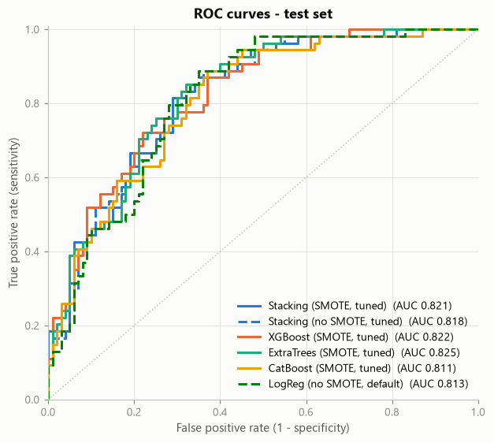
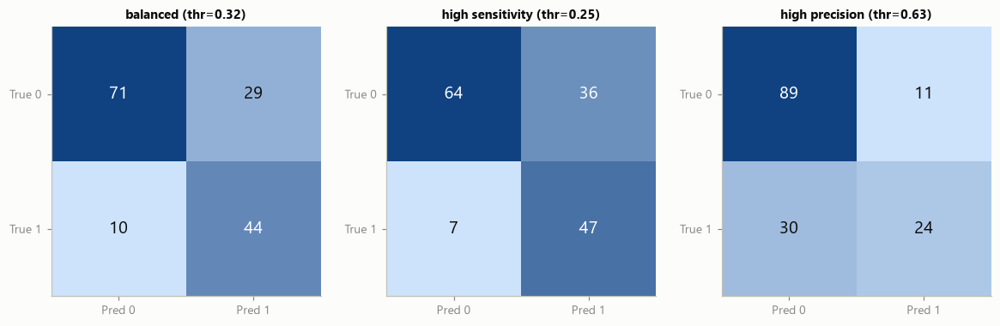
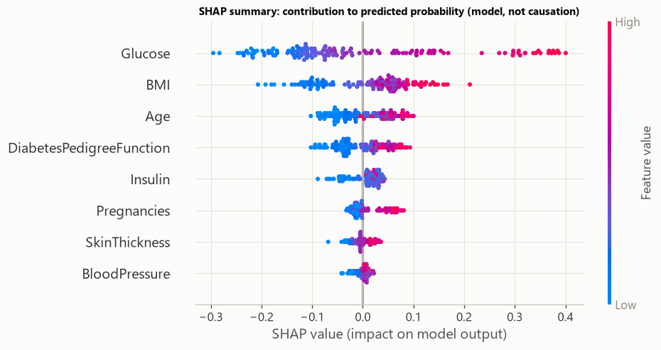
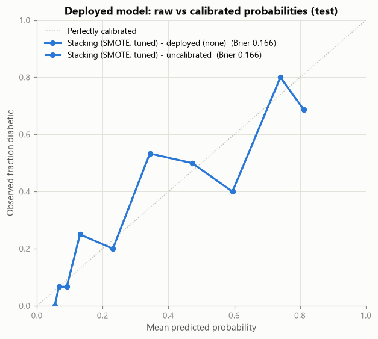
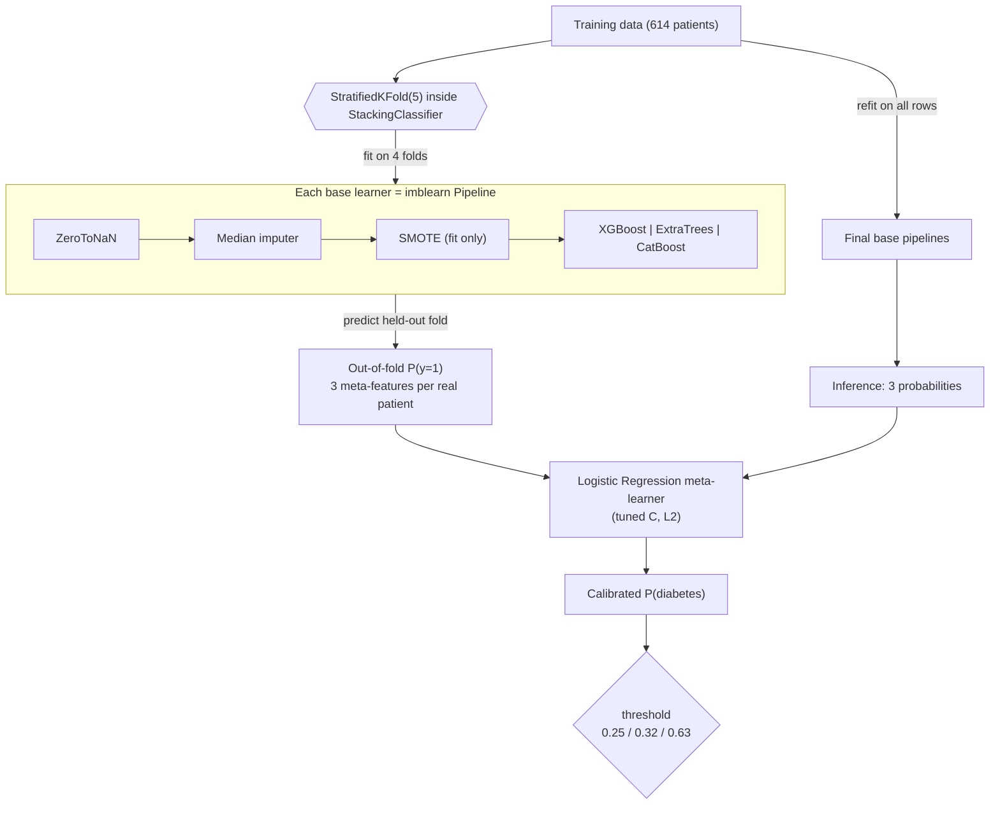
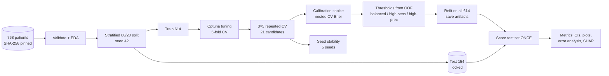
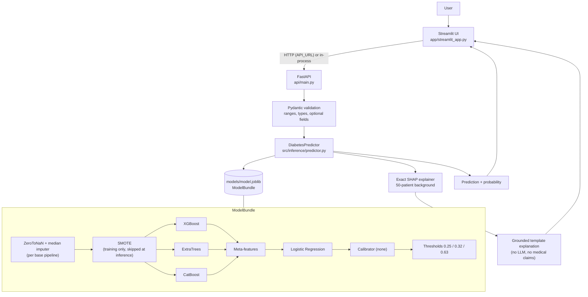
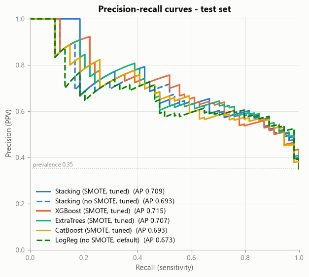
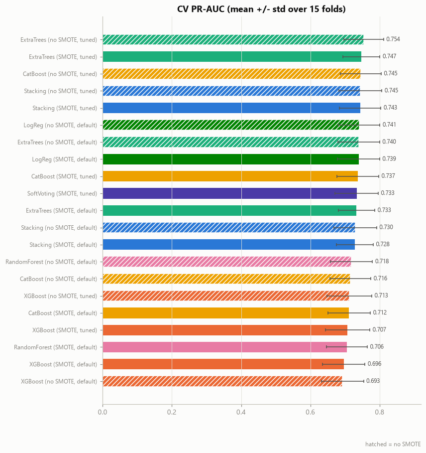
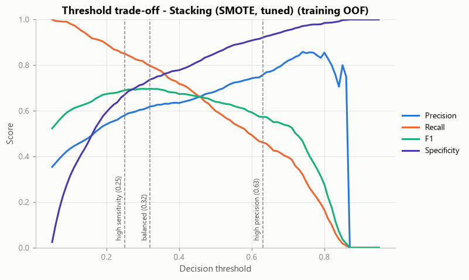

# Smart Health Diabetes Prediction

A diabetes-risk prediction system built on a stacking ensemble, with leakage-safe SMOTE. It covers the full
path from data validation to an explained prediction, served by a FastAPI service and a Streamlit UI. It also
tests its own design choices experimentally (does SMOTE help? does stacking help?).

> ⚠️ **This application is an educational/research prototype and is not a substitute for professional
> medical evaluation.** It is not clinically validated and is not a diagnostic device.

**Team:** undergraduate capstone project (2025), co-developed by **Ashwath M** and **Badri Gopikrishna**.

**Headline (held-out test set, n = 154):** ROC-AUC **0.821**, recall **0.815**, precision 0.603,
F1 **0.693** (95 % CI 0.60–0.78) at a threshold of 0.32 chosen on training data. Stacking **matched but did
not significantly beat** its best base learner, and SMOTE's recall gains came from shifting the threshold
rather than from better ranking. See [Results](#results) and the [final report](reports/final_report.md).

## Results at a glance

<table>
<tr><td width="50%"><br><sub>ROC curves on the held-out test set</sub></td><td width="50%"><br><sub>Deployed model: three operating modes (test set)</sub></td></tr>
<tr><td width="50%"><br><sub>SHAP summary for the deployed stack</sub></td><td width="50%"><br><sub>Calibration before and after</sub></td></tr>
</table>

All figures are in [`reports/figures/`](reports/figures/). Logs: [`reports/logs/`](reports/logs/) (training, evaluation, API smoke test). Full write-up: [`reports/final_report.md`](reports/final_report.md).

---

## Problem Statement

Predict whether a patient is likely to have diabetes from eight routine measurements, as a binary
classification problem. The positive class is the minority (35 %). In a screening-style setting a missed
case (false negative) costs more than a false alarm, so the evaluation focuses on **recall/sensitivity,
precision, F1 and calibration** rather than accuracy.

## Dataset

[Pima Indians Diabetes Database](data/README.md): 768 female patients of Pima Indian heritage aged 21+,
8 features and the target `Outcome` (34.9 % positive). The dataset version is pinned by SHA-256 and verified
on every load.

| Feature | Unit | Note |
|---|---|---|
| Pregnancies | count | 0 is a genuine value |
| Glucose | mg/dL (2-h OGTT) | 5 impossible zeros |
| BloodPressure | mm Hg (diastolic) | 35 impossible zeros |
| SkinThickness | mm | 227 impossible zeros |
| Insulin | µU/mL (2-h) | 374 impossible zeros |
| BMI | kg/m² | 11 impossible zeros |
| DiabetesPedigreeFunction | score | — |
| Age | years | — |

## Data Preprocessing

Every rationale is documented in [data/README.md](data/README.md).

1. **Validation:** schema, dtypes, duplicates (0), explicit NaNs (0), negative values, plausible ranges and target values (`src/data/validation.py`).
2. **Zero → NaN** for Glucose, BloodPressure, SkinThickness, Insulin and BMI, where 0 is physiologically impossible. Zeros in Pregnancies are kept.
3. **Median imputation**, fitted on training folds only and placed inside every pipeline.
4. **Scaling only where needed:** `StandardScaler` for Logistic Regression only. Tree models get raw values.
5. **No outlier removal:** extreme values are clinically plausible.

## Class Imbalance

500 negative vs 268 positive cases, a 1.87 : 1 ratio. Two strategies are compared:
**(a)** SMOTE oversampling, and **(b)** no resampling plus a decision threshold tuned on out-of-fold predictions.

## SMOTE

SMOTE is a step **inside** an `imblearn.pipeline.Pipeline`, so:

- It is refitted on every training fold. Validation, test and inference rows are never resampled, because imblearn skips samplers at predict time. A unit test checks this.
- In the stack, SMOTE lives *inside each base learner's pipeline*, not in front of the stack. The meta-learner is therefore trained only on out-of-fold predictions for **real** patients. If SMOTE ran before the stack, synthetic points interpolated from inner-training patients would leak into the inner validation folds.
- `k_neighbors` is tuned jointly with each model (range 3–10).

## Machine Learning Models

| Model | Variants |
|---|---|
| Logistic Regression | baseline, ± SMOTE |
| Random Forest | baseline, ± SMOTE |
| XGBoost / ExtraTrees / CatBoost | default + Optuna-tuned, ± SMOTE |
| **Stacking** (XGB + ET + CB → LR) | default + tuned, ± SMOTE |
| Soft voting (XGB + ET + CB) | tuned + SMOTE, an ablation of meta-learning vs simple averaging |

That makes 21 candidates, all evaluated with the same repeated stratified CV folds and the same test set.

## Stacking Architecture



`StackingClassifier` builds the meta-features with `cross_val_predict`. Each base pipeline is fitted on 4 inner
folds and predicts the 5th, which gives an n × 3 out-of-fold matrix (sklearn drops the redundant
`P(y=0)` column for binary problems). The meta LR is fitted on that matrix, and each base pipeline is then
refitted on all training rows. Because the meta-learner sees real-prevalence labels, it **re-anchors
SMOTE-inflated base probabilities**, which explains why the stack's recall at 0.5 is lower than that of
its SMOTE-trained base learners.

## Hyperparameter Optimization

Optuna TPE ran 40 trials for XGBoost, 40 for ExtraTrees and 30 for CatBoost. The objective was **5-fold CV
PR-AUC** on the training set. PR-AUC is threshold-free and focused on the positive class, and the threshold is
tuned separately. The search spaces are:

- **XGBoost:** n_estimators, max_depth, learning_rate, subsample, colsample_bytree, min_child_weight, reg_alpha, reg_lambda.
- **ExtraTrees:** n_estimators, max_depth, min_samples_split, min_samples_leaf, max_features.
- **CatBoost:** iterations, depth, learning_rate, l2_leaf_reg.
- **All three:** SMOTE k.

The meta-learner's C and L1/L2 penalty were tuned on the out-of-fold meta-feature matrix. Results are in
[`reports/metrics/tuning_results.json`](reports/metrics/tuning_results.json).

## Evaluation



- **Metrics:** accuracy, precision, recall/sensitivity, specificity, F1, ROC-AUC, PR-AUC, Brier, ECE, log-loss, MCC, and the confusion matrix.
- **Uncertainty:** bootstrap 95 % CIs (2,000 resamples) and paired bootstrap tests for model differences.
- **Thresholds:**
  - *balanced* maximizes OOF F1.
  - *high sensitivity* is the highest threshold with OOF recall ≥ 0.85.
  - *high precision* is the lowest threshold with OOF precision ≥ 0.75.

  All three are chosen on training out-of-fold predictions, **never on the test set**.
- **Calibration:** none, Platt (sigmoid) and isotonic were compared by nested-CV Brier score. A method is adopted only if it improves Brier by ≥ 0.002. For the deployed stack, `none` won.

## Explainable AI

The model is explained with **exact SHAP values** (model-agnostic, 2⁸ coalitions) on the deployed model's
calibrated probability, relative to 50 stratified training patients. Additivity holds to 1e-15. The outputs are:

- global importance and beeswarm/bar plots,
- dependence plots,
- waterfall plots for example TP, FN and FP patients,
- a per-request contribution list plus a grounded, template-generated summary in the API and UI.

Permutation importance and native base-learner importances are provided for cross-checking.

> SHAP values describe **model contributions**, not clinical causation, and are never phrased as medical advice.

| Feature | mean \|SHAP\| (probability) |
|---|---|
| Glucose | 0.147 |
| BMI | 0.075 |
| Age | 0.047 |
| DiabetesPedigreeFunction | 0.041 |
| Insulin | 0.026 |
| Pregnancies | 0.023 |
| SkinThickness | 0.015 |
| BloodPressure | 0.009 |

## API

`uvicorn api.main:app --reload`. Interactive docs are at http://localhost:8000/docs.

| Method | Path | Purpose |
|---|---|---|
| GET | `/health` | Liveness and model-loaded status |
| GET | `/model-info` | Version, thresholds, hyperparameters, CV and test metrics |
| POST | `/predict?mode=balanced\|high_sensitivity\|high_precision&explain=true` | Prediction + SHAP explanation |
| POST | `/parse` | Free text → structured inputs (rule-based; never invents values) |
| POST | `/predict/text` | Parse + predict; unmentioned fields are filled with the training median and **flagged** |
| POST | `/report` | Markdown model-output report for one patient |

```bash
curl -X POST localhost:8000/predict -H "content-type: application/json" -d '{
  "pregnancies": 2, "glucose": 140, "blood_pressure": 80, "skin_thickness": 25,
  "insulin": 100, "bmi": 30.5, "diabetes_pedigree": 0.45, "age": 40}'
```

```json
{"prediction": 1, "label": "higher likelihood", "probability": 0.4645, "threshold": 0.32,
 "threshold_mode": "balanced", "model_version": "stacking_smote_tuned-20261006-17ecf561",
 "risk_statement": "The model predicts a higher likelihood of diabetes based on the supplied features.",
 "imputed_features": [], "warnings": [],
 "explanation": {"base_value": 0.352, "contributions": [{"feature": "Glucose", "value": 140.0,
   "shap_value": 0.066, "direction": "increases"}, "..."], "summary": "...", "note": "..."},
 "disclaimer": "This application is an educational/research prototype and is not a substitute for professional medical evaluation."}
```

Input validation is handled by Pydantic:

- Impossible values (glucose 0, negative BMI, age > 120), unknown fields and wrong types return HTTP 422 with field-level errors.
- `skin_thickness` and `insulin` are optional. Omitted values are imputed and listed in `imputed_features`.
- Values outside the training range add an extrapolation warning.

Steady-state latency is about 0.3–0.45 s with SHAP and about 30 ms without.

## Web Application

`streamlit run app/streamlit_app.py` serves five pages:

| Page | Contents |
|---|---|
| **Home** | Overview, test metrics, disclaimer |
| **Diabetes Prediction** | Form for all 8 inputs (insulin and skin thickness optional) and an operating-mode selector. Shows the probability bar against all thresholds, a SHAP contribution chart, a plain-language summary and a downloadable report. A free-text box pre-fills the form. |
| **Model Performance** | Filterable comparison table (family / SMOTE / tuned), interactive ROC/PR/calibration curves and confusion matrices for any 6 models, a SMOTE-vs-no-SMOTE tab, a threshold explorer (live TP/FP/FN/TN), and CV boxplots with seed stability |
| **Explainability** | Global SHAP, permutation importance, stacking internals (meta coefficients, diversity, ablation), error analysis, example waterfalls |
| **About Model** | Pipeline, intended use, limitations, full metadata |

The UI uses the API when `API_URL` is set (as in docker-compose) and loads the model in-process otherwise.
Output language is always *"The model predicts a higher/lower likelihood of diabetes based on the supplied
features"*, never a diagnosis.

## Architecture



**AI-enhancement decision.** No LLM is used in v1. The prediction is made only by the ML model. The
"explanation assistant" (option 1), the natural-language input parser (option 2) and the patient report
(option 3) are all **deterministic and grounded**: the text is generated from the model's own SHAP values,
and the parser never fills a value it did not read without flagging it. This meets the brief's requirement
that the LLM must not override the model or fabricate facts, without depending on an API key. An optional
local-LLM rephrasing layer is listed under future work.

## Installation

Requires Python 3.11–3.13. Results were produced with Python 3.12.10 on Windows 11 with 24 CPU threads.

```bash
python -m venv .venv
# Windows: .venv\Scripts\activate    macOS/Linux: source .venv/bin/activate
pip install -r requirements.txt       # exact pinned versions
python scripts/download_data.py       # only needed if data/raw/diabetes.csv is missing
```

## Usage

```bash
python scripts/train.py            # ~3 min: validation, EDA, tuning, CV of 21 candidates, stability, artifacts
python scripts/evaluate.py         # ~1.5 min: one-time test evaluation, figures, error analysis, SHAP
pytest -q                          # 63 tests
uvicorn api.main:app --reload      # API on :8000
streamlit run app/streamlit_app.py # UI on :8501
mlflow ui --backend-store-uri sqlite:///mlflow.db --workers 1   # tracking UI on :5000 (1 worker avoids WinError 10022 on Windows)
```

Useful flags:

- `python scripts/train.py --quick` runs a 1-minute smoke test (not for reporting).
- `--reuse-tuning` skips Optuna.

With Docker:

```bash
docker build -t smart-health-diabetes:serve .
docker run -p 8000:8000 smart-health-diabetes:serve                       # API
docker compose up --build                                                 # API + UI (UI calls API)
docker compose --profile train run --rm trainer                           # retrain inside Docker
docker compose --profile tracking up mlflow                               # MLflow UI
```

On Linux/macOS, `make train`, `make evaluate`, `make test`, `make api` and `make app` wrap the same commands.

### Project structure

```
├── api/main.py                     FastAPI service
├── app/streamlit_app.py            Streamlit UI (5 pages)
├── configs/config.yaml             all settings (seeds, CV, search budgets, thresholds, paths)
├── data/README.md                  dataset source, checksum, preprocessing decisions (data itself not committed)
├── notebooks/01..06_*.ipynb        executed exploration notebooks (EDA, baselines, SMOTE, stacking, XAI, errors)
├── src/
│   ├── config.py
│   ├── data/          loader.py validation.py preprocessing.py eda.py
│   ├── features/      engineering.py (optional, off by default)
│   ├── models/        baselines.py xgboost_model.py extratrees_model.py catboost_model.py
│   │                  stacking_model.py calibration.py common.py registry.py bundle.py
│   ├── training/      train.py tune.py cross_validation.py tracking.py
│   ├── evaluation/    metrics.py plots.py error_analysis.py evaluate.py
│   ├── explainability/ shap_analysis.py feature_importance.py
│   └── inference/     predictor.py schemas.py explanation.py nl_parser.py
├── scripts/           train.py evaluate.py download_data.py
├── tests/             test_data.py test_preprocessing.py test_model.py test_api.py
├── models/            model_metadata.json (model.joblib, shap_background.csv, candidates/ are written by training, not committed)
├── reports/           final_report.md results_summary.md figures/ metrics/ logs/
├── .github/workflows/ci.yml   tests on every push (downloads the public dataset first)
├── Dockerfile  docker-compose.yml  Makefile  pyproject.toml  requirements*.txt  LICENSE
```

## Results

### Test-set comparison

Each model is shown at its own threshold, selected by CV on the training data. These are selected rows; all 21 are in
[`reports/results_summary.md`](reports/results_summary.md).

| Model | Thr | Acc | Prec | Recall | F1 | ROC-AUC | PR-AUC | Spec | Brier |
|---|---|---|---|---|---|---|---|---|---|
| **Stacking + SMOTE, tuned (selected)** | 0.32 | 0.747 | 0.603 | 0.815 | **0.693** | 0.821 | 0.709 | 0.710 | 0.166 |
| ExtraTrees + SMOTE, tuned | 0.31 | 0.734 | 0.584 | 0.833 | 0.687 | 0.825 | 0.707 | 0.680 | 0.164 |
| Soft voting + SMOTE, tuned | 0.31 | 0.734 | 0.587 | 0.815 | 0.682 | 0.821 | 0.707 | 0.690 | 0.164 |
| Stacking, no SMOTE, tuned | 0.24 | 0.721 | 0.568 | 0.852 | 0.681 | 0.818 | 0.693 | 0.650 | 0.169 |
| XGBoost + SMOTE, tuned | 0.33 | 0.734 | 0.594 | 0.759 | 0.667 | 0.822 | 0.715 | 0.720 | 0.163 |
| CatBoost + SMOTE, tuned | 0.30 | 0.714 | 0.566 | 0.796 | 0.662 | 0.811 | 0.693 | 0.670 | 0.170 |
| Logistic Regression | 0.37 | 0.734 | 0.614 | 0.648 | 0.631 | 0.813 | 0.673 | 0.780 | 0.175 |

### SMOTE vs no SMOTE (CV on training set, threshold 0.5)

| Model | SMOTE | Precision | Recall | F1 | ROC-AUC | PR-AUC |
|---|---|---|---|---|---|---|
| Logistic Regression | no | 0.752 | 0.573 | 0.646 | 0.842 | 0.741 |
| Logistic Regression | yes | 0.652 | 0.718 | 0.680 | 0.841 | 0.739 |
| ExtraTrees (tuned) | no | 0.788 | 0.471 | 0.585 | 0.845 | 0.754 |
| ExtraTrees (tuned) | yes | 0.646 | 0.740 | 0.686 | 0.845 | 0.747 |
| CatBoost (tuned) | no | 0.715 | 0.559 | 0.623 | 0.840 | 0.745 |
| CatBoost (tuned) | yes | 0.638 | 0.755 | 0.689 | 0.837 | 0.737 |
| Stacking (tuned) | no | 0.712 | 0.564 | 0.625 | 0.841 | 0.745 |
| Stacking (tuned) | yes | 0.698 | 0.600 | 0.640 | 0.841 | 0.743 |

### Hypothesis checks

| Hypothesis | Measured | Verdict |
|---|---|---|
| SMOTE improves minority recall (~18 %) | Recall@0.5 +3.4 to +26.9 pp (6–57 % relative; RF exactly 18.0 %). PR-AUC unchanged or slightly lower. The deployed stack gains +3.6 pp (6.3 %) in CV. | **Partially true, but misleading.** It is a threshold effect, and tuning the threshold gives the same recall without SMOTE. |
| Stacking beats individual classifiers in F1 (6–8 %) | CV F1@0.5 −3 % to −7 %. Test F1 at tuned thresholds +0.9 % to +4.7 %, with every bootstrap CI including 0. Stack beat all bases on PR-AUC in 0/5 seeds. Base predictions correlate at 0.93–0.96. | **Not supported.** The stack ties its best base learner. |

Figures (in `reports/figures/`):







## Limitations

- **Small sample.** 768 patients, with 154 in the test set. Test-metric CIs are about ±0.08, and differences between top models are smaller than the noise.
- **Narrow population.** The cohort is a single population (Pima Indian women aged 21+, historical data), with no external validation.
- **Missingness.** About half of the Insulin values and 30 % of SkinThickness values were imputed.
- **Label overlap.** Glucose (the OGTT value) is part of the label definition, so its dominance is partly by construction.
- **Tuning optimism.** Hyperparameters were tuned on the same training data used for the CV comparison (no nested CV). The test set remains unbiased.
- **No fairness audit.** The protected attributes needed for one are not available.

## Ethical Considerations

- This is a decision-support prototype for education. Its outputs are probabilities with uncertainty, never diagnoses.
- Wording is constrained ("higher/lower likelihood"), and every page and API response carries a disclaimer.
- SHAP outputs are explicitly labelled as model contributions, not causes.
- Missed diabetic patients are disproportionately younger, leaner and normoglycaemic (see the error analysis), so a negative prediction for such patients is especially weak evidence.
- Training on one ethnic group risks miscalibration for others. Do not use the model outside this population without re-validation.
- No personal data is stored. The API is stateless.

## Future Work

See [the version-2 improvements](#version-2) below and §8 of the [final report](reports/final_report.md).

---

<a id="version-2"></a>
### Concrete improvements for version 2

1. **Nested CV** (tuning inside outer folds) for unbiased model comparison, plus a Bayesian or corrected-resampled t-test across folds.
2. **Simpler deployment candidate.** ExtraTrees (no SMOTE) or LR match the stack and are cheaper and easier to explain. Pre-register a "simplest model within 1 SE" selection rule.
3. **Better imputation.** Iterative imputation with indicators, evaluated as an ablation, plus sensitivity analysis on Insulin/SkinThickness missingness.
4. **Cost-sensitive learning.** Use class weights or `scale_pos_weight` and an explicit FN:FP cost ratio to set the threshold, instead of SMOTE.
5. **External validation** on a different cohort (e.g., NHANES with HbA1c labels) and recalibration for new populations.
6. **More diverse base learners.** Add kNN, SVM or a GAM to reduce the 0.93–0.96 correlation between the current bases, or drop the redundant XGBoost.
7. **Conformal prediction** for per-patient uncertainty sets.
8. **Optional local LLM** (e.g., via Ollama) only to rephrase the grounded SHAP summary. It would take the structured explanation as input, have no free-form medical content and be checked by tests.
9. **Monitoring.** Input drift detection, request logging with privacy safeguards, and a CI pipeline running `train --quick` and the tests.
